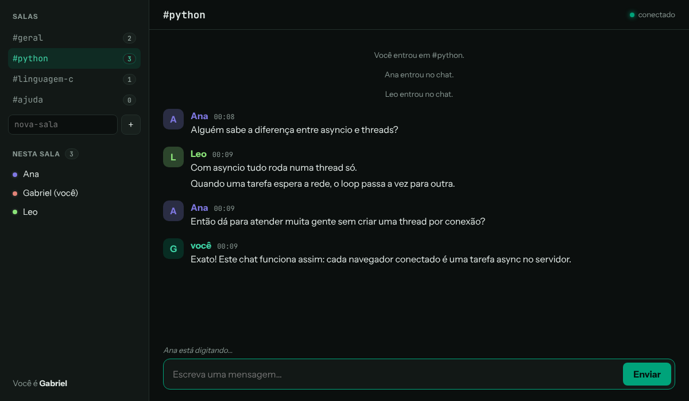

# 💬 Chat em Tempo Real

Chat no navegador com **salas**, **lista de quem está online** e **"fulano está digitando…"**. O servidor é em Python com **asyncio** e **aiohttp**, e as mensagens chegam na hora por **WebSocket**. O front-end é **HTML, CSS e JavaScript puro**, sem frameworks.



## Funcionalidades

- **Mensagens instantâneas** entre todos os navegadores conectados
- **Salas**: quatro fixas (`#geral`, `#python`, `#linguagem-c`, `#ajuda`) e quantas mais quiser criar. Uma sala criada some quando a última pessoa sai.
- **Histórico**: quem entra vê as últimas 50 mensagens da sala
- **Quem está online** em cada sala, e quantas pessoas há em cada uma
- Aviso de **"está digitando…"**
- Avisos de entrada, saída e troca de sala
- **Apelidos únicos** (sem diferenciar maiúsculas de minúsculas)
- **Limite anti-spam**: até 5 mensagens a cada 5 segundos por pessoa
- **Reconexão automática** se o servidor cair ou a internet oscilar, voltando para a mesma sala
- Mensagens seguidas da mesma pessoa ficam agrupadas, e cada apelido tem sempre a mesma cor
- Contador de mensagens não lidas no título da aba
- Link direto para uma sala: `http://127.0.0.1:8080/#python`
- Funciona no celular, com o menu de salas em uma gaveta lateral
- 33 testes automatizados com `pytest` e `pytest-aiohttp`

## Como funciona

```
 Navegador (app.js)                       Servidor (aiohttp)
 ──────────────────                       ──────────────────
 abre ws://.../ws  ─────────────────────► conexao_websocket()  (uma tarefa async por navegador)
 {"tipo":"entrar","apelido":"Ana"} ─────► Chat.entrar()
                   ◄──────────────────── {"tipo":"bem_vindo", "historico":[...], ...}
 {"tipo":"mensagem","texto":"Oi"} ──────► Chat.enviar_mensagem()
                   ◄──────────────────── {"tipo":"mensagem", ...}  ← para todos da sala
```

Com HTTP comum, o navegador pergunta e o servidor responde. Com **WebSocket**, a conexão fica aberta e o **servidor pode mandar mensagens a qualquer momento**, que é o que um chat precisa.

O servidor usa **asyncio**: tudo roda numa thread só, e enquanto uma conexão espera a rede, o loop atende as outras. Assim ele aguenta muitas pessoas sem criar uma thread para cada uma.

### Protocolo

Todas as mensagens são objetos JSON com um campo `tipo`.

| Do navegador para o servidor | Do servidor para o navegador |
|------------------------------|------------------------------|
| `entrar` (apelido, sala) | `bem_vindo` (sala, histórico, pessoas) |
| `mensagem` (texto) | `mensagem` (apelido, texto, horário) |
| `trocar_sala` (sala) | `sistema` (avisos de entrada e saída) |
| `digitando` | `usuarios`, `salas`, `digitando`, `erro` |

## Estrutura

```
chat-tempo-real/
├── chat_tempo_real/
│   ├── __main__.py        # Inicia o servidor (python -m chat_tempo_real)
│   ├── servidor.py        # Rotas aiohttp e a conexão WebSocket
│   ├── salas.py           # Regras do chat: apelidos, salas, histórico, anti-spam
│   └── static/
│       ├── index.html     # Tela de entrada e tela do chat
│       ├── app.js         # Conexão, reconexão e montagem das mensagens
│       └── style.css      # Tema escuro preto e verde jade
├── tests/
│   ├── test_salas.py      # Regras, com conexões falsas (sem servidor)
│   └── test_servidor.py   # Servidor de verdade com dois "navegadores"
├── docs/preview.png
├── pyproject.toml
├── requirements.txt       # aiohttp
└── requirements-dev.txt   # pytest, pytest-aiohttp
```

As regras ficam em `salas.py`, que **não depende do aiohttp**: ele só precisa de conexões com um método `send_json`. Por isso os testes de regras usam conexões falsas que só guardam o que receberam.

## Como instalar e executar

1. Entre na pasta e crie um ambiente virtual:
   ```bash
   cd chat-tempo-real
   python -m venv .venv
   # Windows:
   .venv\Scripts\activate
   # Linux/macOS:
   source .venv/bin/activate
   ```
2. Instale as dependências:
   ```bash
   pip install -r requirements.txt
   ```
3. Inicie o servidor:
   ```bash
   python -m chat_tempo_real
   ```
4. Abra **http://127.0.0.1:8080** em **duas abas** (ou em dois navegadores), entre com apelidos diferentes e converse.

### Conversar com outras pessoas da mesma rede

```bash
python -m chat_tempo_real --host 0.0.0.0
```

O programa mostra o endereço para os outros abrirem, algo como `http://192.168.0.15:8080`. No Windows, permita o acesso quando o Firewall perguntar. Para usar outra porta: `--porta 9000`.

## Segurança

- As mensagens são inseridas na página com `textContent`, **nunca** com `innerHTML`. Quem mandar `<script>` ou `` só aparece como texto (ataque *XSS*).
- O servidor **valida tudo** que chega: JSON mal formado, tipo desconhecido, apelido ou sala inválidos e textos vazios ou acima de 500 caracteres viram uma mensagem de erro, sem derrubar a conexão.
- Mensagens WebSocket maiores que 8 KB são recusadas.
- Uma conexão que cai sem aviso é detectada pelo *heartbeat* (ping a cada 30 s), e a pessoa sai da lista.

> Este chat é para aprender e usar na rede local. Para colocar na internet, ainda seriam necessários HTTPS (`wss://`), contas com senha e um banco de dados para guardar o histórico.

## Testes

```bash
pip install -r requirements-dev.txt
pytest -v
```

`test_salas.py` testa as regras sem servidor, controlando o relógio para testar o limite anti-spam. `test_servidor.py` sobe o servidor de verdade e conecta dois clientes WebSocket para conferir a conversa, o histórico, os erros e a saída quando a conexão cai.

## Conceitos praticados

- **WebSocket** no servidor (`aiohttp`) e no navegador (`WebSocket` do JavaScript)
- **asyncio**: `async`/`await`, `asyncio.gather` e `asyncio.shield`
- Um **protocolo próprio** em JSON entre front-end e back-end
- Separar as **regras** da parte de rede para poder testá-las
- `dataclass`, `deque` com tamanho máximo e expressões regulares
- JavaScript puro: manipulação do DOM, eventos e reconexão com espera crescente
- CSS com variáveis, Grid, Flexbox e layout para celular
- Testes assíncronos com `pytest-aiohttp`
