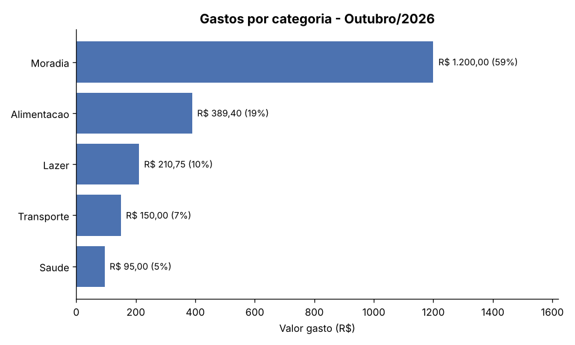

# 💰 Controle de Gastos Pessoais

Programa de terminal em Python para **registrar receitas e despesas**, ver o **saldo do mês** e descobrir **para onde o dinheiro está indo**, com um gráfico de gastos por categoria.



## Funcionalidades

- **Registrar** receitas e despesas com valor, categoria, descrição e data
- **Listar** as transações de qualquer mês
- **Resumo mensal:** receitas, despesas, saldo e porcentagem gasta em cada categoria
- **Gráfico** de gastos por categoria, salvo como imagem PNG (`matplotlib`)
- **Remover** transações pelo ID
- **Menu interativo** (sem argumentos) ou **comandos diretos** (para usar em scripts)
- Aceita valores no formato brasileiro (`1.234,56`) e datas `dd/mm/aaaa`
- Dados salvos em `gastos.json`, com gravação segura que não corrompe o arquivo se o programa travar
- 21 testes automatizados com `pytest`

## Estrutura

```
controle-gastos/
├── controle_gastos/
│   ├── __init__.py
│   ├── __main__.py        # Menu interativo e comandos (argparse)
│   ├── modelo.py          # Classe Transacao e validação das entradas
│   ├── armazenamento.py   # Leitura e gravação do arquivo JSON
│   ├── relatorios.py      # Resumo, totais por categoria e formatação em R$
│   └── grafico.py         # Gráfico com matplotlib
├── tests/
│   └── test_controle_gastos.py
├── docs/
│   └── exemplo-grafico.png
├── pyproject.toml         # Configuração do pytest
├── requirements.txt       # matplotlib
├── requirements-dev.txt   # pytest
└── README.md
```

## Dependências

- **Python 3.10** ou mais recente
- `matplotlib`, só para o comando de gráfico. Todo o resto funciona sem ele.
- `pytest` apenas para rodar os testes

## Como instalar e executar

1. Entre na pasta do projeto:
   ```bash
   cd controle-gastos
   ```
2. (Recomendado) Crie um ambiente virtual:
   ```bash
   python -m venv .venv
   # Windows:
   .venv\Scripts\activate
   # Linux/macOS:
   source .venv/bin/activate
   ```
3. Instale as dependências:
   ```bash
   pip install -r requirements.txt
   ```
4. Abra o menu interativo:
   ```bash
   python -m controle_gastos
   ```

> No Windows, se `python` não funcionar, use `py`. No Linux/macOS, pode ser `python3`.

## Usando os comandos diretos

```bash
# Registrar (tipo pode ser "receita"/"despesa" ou só "r"/"d")
python -m controle_gastos adicionar receita 3.500,00 -c Salario -d "Salario de outubro"
python -m controle_gastos adicionar d 389,40 -c Alimentacao -d Mercado --data 07/10/2026

# Consultar (sem --mes, usa o mês atual)
python -m controle_gastos listar --mes 10/2026
python -m controle_gastos resumo --mes 10/2026

# Gerar o gráfico (salva grafico-2026-10.png; --mostrar abre uma janela)
python -m controle_gastos grafico --mes 10/2026

# Remover pelo ID mostrado na listagem
python -m controle_gastos remover 3

# Ajuda
python -m controle_gastos --help
```

## Exemplo de resumo

```
=== Resumo de Outubro/2026 ===
  Receitas :      R$ 3.500,00
  Despesas :      R$ 2.045,15
  Saldo    :      R$ 1.454,85

  Gastos por categoria:
  Moradia           R$ 1.200,00   58.7%  ############
  Alimentacao         R$ 389,40   19.0%  ####
  Lazer               R$ 210,75   10.3%  ##
  Transporte          R$ 150,00    7.3%  #
  Saude                R$ 95,00    4.6%  #
```

## Detalhes técnicos

- **`Decimal` para dinheiro:** `float` gera erros como `0.1 + 0.2 = 0.30000000000000004`. Com `Decimal`, os centavos sempre fecham.
- **Gravação segura:** o JSON é escrito primeiro em um arquivo temporário e só depois substitui o original com `os.replace`.
- **Importação tardia:** o `matplotlib` só é carregado quando o gráfico é pedido, então o programa abre rápido e funciona mesmo sem ele.
- **Privacidade:** `gastos.json` e os gráficos gerados estão no `.gitignore`, para que seus dados financeiros nunca vão parar no GitHub.

## Rodando os testes

```bash
pip install -r requirements-dev.txt
pytest -v
```

## Conceitos praticados

`dataclass`, `Decimal`, `datetime`, leitura e escrita de JSON, `pathlib`, `argparse` com subcomandos, `collections.defaultdict`, gráficos com `matplotlib`, modularização em pacotes, testes com `pytest` (fixtures, `tmp_path`, `monkeypatch`).
