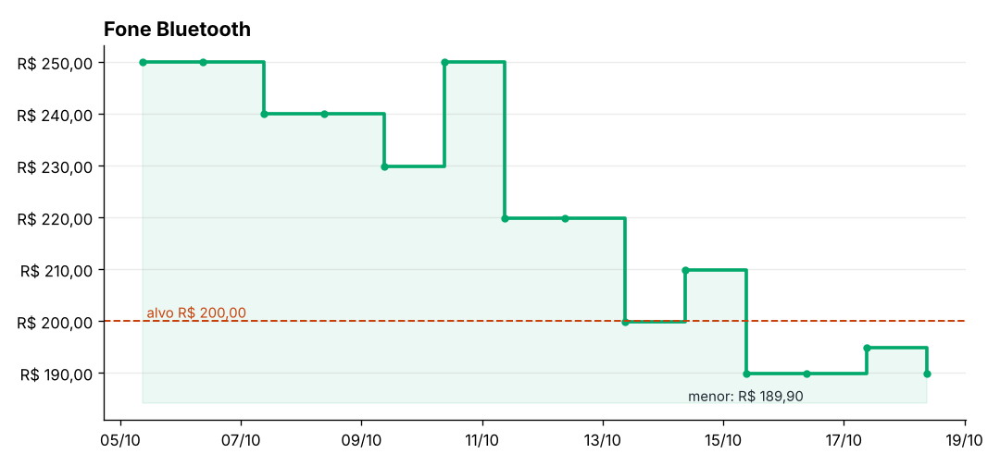

# 🏷️ Raspador de Preços com Alerta

Programa de terminal que **acompanha o preço de produtos em lojas online**, guarda o histórico em CSV e **avisa por e-mail ou Telegram** quando o preço chega ao valor que você quer pagar.



## Funcionalidades

- **Extrai o preço** de qualquer página com um **seletor CSS** (`.preco-atual`, `#preco`...) ou, sem seletor, pelos dados estruturados **schema.org** (JSON-LD) que muitas lojas publicam
- Entende preços no formato brasileiro (`R$ 1.299,90`) e guarda tudo como `Decimal`, sem erros de arredondamento
- **Respeita o `robots.txt`** de cada site e espera 2 segundos entre acessos ao mesmo site
- **Histórico** de todas as verificações em `historico.csv` (abre no Excel)
- **Alertas** quando o preço chega ao alvo ou cai em relação à última verificação
- Envio por **e-mail (SMTP)** e/ou **Telegram**, com as senhas num arquivo `.env` fora do código
- **Gráfico** da variação de preço com `matplotlib`
- Modo **vigiar**, que verifica sozinho a cada N minutos
- **Loja de demonstração** embutida para testar sem acessar nenhum site de verdade
- 25 testes automatizados com `pytest` (sem acessar a internet)

## Estrutura

```
raspador-precos/
├── raspador_precos/
│   ├── __main__.py        # Comandos de terminal (argparse) e a verificação
│   ├── extrator.py        # Encontra o preço no HTML (BeautifulSoup)
│   ├── coleta.py          # Baixa a página respeitando robots.txt e pausas
│   ├── armazenamento.py   # produtos.json e historico.csv
│   ├── alertas.py         # Quando avisar, e-mail, Telegram e .env
│   └── grafico.py         # Gráfico com matplotlib
├── loja_demo/             # Páginas de uma loja fictícia para o comando "demo"
├── tests/
│   └── test_raspador.py
├── docs/exemplo-grafico.png
├── .env.exemplo           # Modelo de configuração dos alertas
├── pyproject.toml
├── requirements.txt       # requests, beautifulsoup4, matplotlib
└── requirements-dev.txt   # pytest
```

## Como instalar

```bash
cd raspador-precos
python -m venv .venv
# Windows:
.venv\Scripts\activate
# Linux/macOS:
source .venv/bin/activate

pip install -r requirements.txt
```

## Primeiro teste: a loja de demonstração

```bash
python -m raspador_precos demo
```

```
Loja de demonstração rodando em http://127.0.0.1:42531

  • Fone Bluetooth: R$ 189,90
    🔔 chegou ao preço alvo de R$ 200,00
  • Teclado Mecânico: R$ 279,90
  • Mouse sem Fio: R$ 89,90
```

O programa sobe uma lojinha no seu próprio computador e lê os três produtos de jeitos diferentes: o fone pelo seletor `.preco-atual`, o mouse pelo seletor `#preco` e o teclado pelo JSON-LD, sem seletor nenhum.

## Usando com lojas de verdade

```bash
# Cadastrar um produto (o preço alvo é opcional)
python -m raspador_precos adicionar "Fone XYZ" "https://www.loja.com.br/produto/123" --alvo 199,90

# Se o preço não for encontrado automaticamente, informe o seletor CSS
python -m raspador_precos adicionar "Fone XYZ" "https://..." --alvo 199,90 --seletor ".price-value"

python -m raspador_precos listar         # produtos e último preço
python -m raspador_precos verificar      # busca os preços agora
python -m raspador_precos historico      # todas as verificações
python -m raspador_precos grafico "Fone XYZ"   # salva grafico-fone-xyz.png
python -m raspador_precos remover "Fone XYZ"
```

### Como descobrir o seletor CSS do preço

1. Abra a página do produto no navegador.
2. Clique com o botão direito em cima do preço e escolha **Inspecionar**.
3. Veja a `class` ou o `id` do elemento destacado. Por exemplo, `<span class="price-value">` vira o seletor `.price-value`, e `<div id="preco">` vira `#preco`.
4. Teste no console do navegador (F12 > Console): `document.querySelector(".price-value").textContent`.

> Muitas lojas montam a página com JavaScript depois que ela carrega. Se o preço não aparece em **Exibir código-fonte** (Ctrl+U), o `requests` também não vai enxergá-lo, e o raspador mostra "preço não encontrado".

## Configurando os alertas

Copie `.env.exemplo` para `.env` e preencha o canal que quiser usar:

```bash
cp .env.exemplo .env      # Windows: copy .env.exemplo .env
```

- **E-mail (Gmail):** ative a verificação em duas etapas e crie uma **senha de app** em *Conta Google > Segurança > Senhas de app*. Use essa senha em `EMAIL_SENHA`.
- **Telegram:** crie um bot com o [@BotFather](https://t.me/BotFather), coloque o token em `TELEGRAM_TOKEN`, mande uma mensagem para o bot e pegue o seu `chat id` em `https://api.telegram.org/bot<TOKEN>/getUpdates`.

O arquivo `.env` está no `.gitignore`, então suas senhas nunca vão para o GitHub.

## Verificando automaticamente

**Opção 1: deixar o terminal aberto**

```bash
python -m raspador_precos vigiar --intervalo 120   # a cada 2 horas
```

**Opção 2: agendar no sistema** (melhor, não precisa de terminal aberto)

- **Linux/macOS (cron):** rode `crontab -e` e adicione uma linha para verificar todo dia às 9h:
  ```
  0 9 * * * cd /caminho/para/raspador-precos && .venv/bin/python -m raspador_precos verificar
  ```
- **Windows (Agendador de Tarefas):** crie uma tarefa básica com o programa `C:\caminho\raspador-precos\.venv\Scripts\python.exe`, argumentos `-m raspador_precos verificar` e a opção *Iniciar em* apontando para a pasta `raspador-precos`.

## Uso responsável

- O programa lê o `robots.txt` de cada site e **não acessa** páginas que o site pede para robôs não acessarem.
- Ele se identifica com um `User-Agent` próprio e faz uma pausa entre acessos ao mesmo site.
- Verifique poucas vezes por dia: preço de loja raramente muda de hora em hora.
- Leia os termos de uso da loja. Alguns sites proíbem coleta automática; nesse caso, não use o raspador neles.

## Testes

```bash
pip install -r requirements-dev.txt
pytest -v
```

Os testes usam HTML de exemplo e simulam as respostas da rede, então rodam sem internet.

## Conceitos praticados

- **Web scraping** com `requests` e `BeautifulSoup` (seletores CSS e JSON-LD)
- `urllib.robotparser` para respeitar as regras de cada site
- `Decimal` para dinheiro, `dataclass`, `csv` e `json`
- `argparse` com subcomandos
- Envio de e-mail com `smtplib` e chamada à API do Telegram
- Configuração por variáveis de ambiente (`.env`)
- Testes com `pytest` e `monkeypatch` para simular a rede
