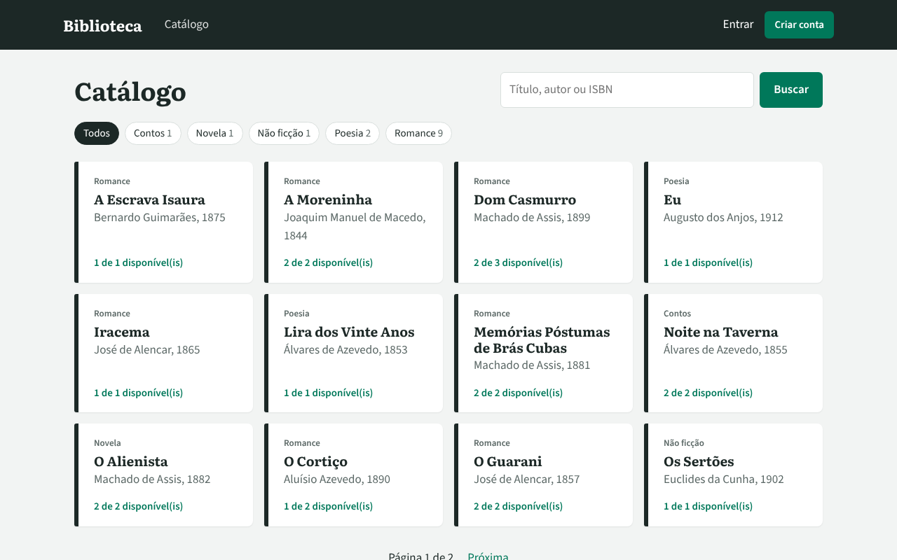
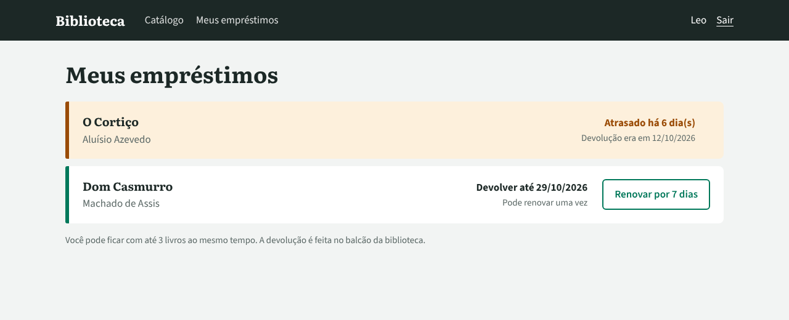
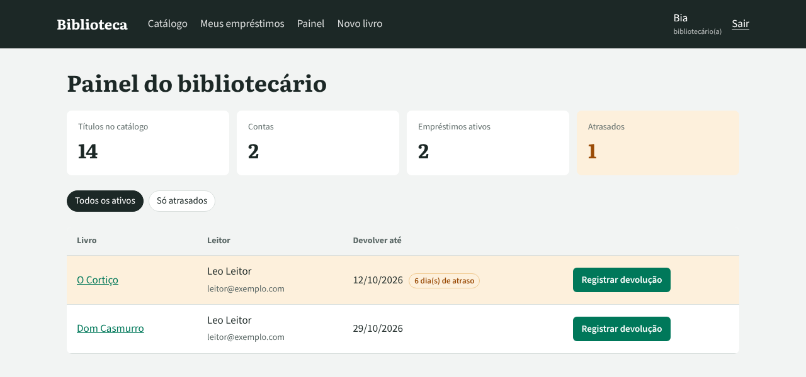

# 📚 Sistema de Biblioteca

Aplicação web em **Flask** para gerenciar uma biblioteca: catálogo de livros com busca, **cadastro e login de usuários**, empréstimos com prazo, renovação e controle de atrasos, e uma área separada para **bibliotecários**.



## Funcionalidades

**Para todos**
- Catálogo com **busca** por título, autor ou ISBN, **filtro por gênero** e **paginação**
- Página de cada livro com a quantidade de exemplares disponíveis

**Para leitores** (conta criada no próprio site)
- Cadastro e login com senha guardada como **hash** (nunca em texto puro)
- Pegar livro emprestado com um clique: prazo de **14 dias**
- **Meus empréstimos**: prazos, atrasos destacados e histórico
- **Renovar** uma vez por mais 7 dias, se o livro não estiver atrasado

**Para bibliotecários**
- **Painel** com totais, lista de empréstimos ativos e filtro "só atrasados"
- Registrar devoluções
- Cadastrar, editar e excluir livros, com **validação do dígito verificador do ISBN**

**Regras de negócio**
- No máximo **3 livros** ao mesmo tempo por leitor
- Quem tem livro **atrasado** não pega outro até devolver
- O mesmo leitor não pega dois exemplares do mesmo livro
- Não dá para excluir um livro emprestado, nem reduzir os exemplares abaixo do que está emprestado

**Segurança**
- Proteção **CSRF** em todos os formulários (Flask-WTF)
- Ações que alteram dados só aceitam `POST`
- Rotas de bibliotecário bloqueadas para leitores (erro 403)
- Redirecionamento após login só para páginas do próprio site (evita *open redirect*)
- Mensagem de login errado não revela se o e-mail existe

| Meus empréstimos | Painel do bibliotecário |
|---|---|
|  |  |

## Estrutura

```
sistema-biblioteca/
├── biblioteca/
│   ├── __init__.py        # create_app: configuração e registro das partes
│   ├── extensoes.py       # SQLAlchemy, LoginManager e CSRF
│   ├── modelos.py         # Tabelas: Usuario, Livro, Emprestimo
│   ├── regras.py          # Regras de empréstimo, devolução e renovação
│   ├── formularios.py     # Formulários e validações (WTForms)
│   ├── auth.py            # Cadastro, login, logout e permissões
│   ├── livros.py          # Catálogo e cadastro de livros
│   ├── emprestimos.py     # Meus empréstimos e painel do bibliotecário
│   ├── comandos.py        # Comandos de terminal: popular, criar-bibliotecario
│   ├── templates/         # Páginas HTML (Jinja2)
│   └── static/style.css
├── tests/
│   ├── conftest.py        # App de teste com banco em memória
│   └── test_biblioteca.py
├── docs/                  # Imagens do README
├── pyproject.toml
├── requirements.txt       # flask, flask-sqlalchemy, flask-login, flask-wtf, email-validator
└── requirements-dev.txt   # pytest
```

As **regras de negócio** ficam em `regras.py`, separadas das rotas. Assim elas podem ser testadas sem abrir o navegador, e as rotas só cuidam de receber o pedido e mostrar o resultado.

## Como instalar e executar

1. Entre na pasta e crie um ambiente virtual:
   ```bash
   cd sistema-biblioteca
   python -m venv .venv
   # Windows:
   .venv\Scripts\activate
   # Linux/macOS:
   source .venv/bin/activate
   ```
2. Instale as dependências:
   ```bash
   pip install -r requirements.txt
   ```
3. Preencha o banco com livros e contas de exemplo:
   ```bash
   flask --app biblioteca popular
   ```
4. Inicie o servidor:
   ```bash
   flask --app biblioteca run --debug
   ```
5. Abra **http://127.0.0.1:5000** no navegador.

### Contas de exemplo

| Papel | E-mail | Senha |
|-------|--------|-------|
| Bibliotecária | `bibliotecaria@exemplo.com` | `senha1234` |
| Leitor | `leitor@exemplo.com` | `senha1234` |

O leitor de exemplo já começa com um livro **atrasado**, então dá para ver o bloqueio de novos empréstimos funcionando. Registre a devolução pela conta da bibliotecária e tente de novo.

### Criar um bibliotecário de verdade

```bash
flask --app biblioteca criar-bibliotecario
```

O comando pede nome, e-mail e senha. Se o e-mail já tiver uma conta de leitor, ela é promovida a bibliotecário.

### Configuração

| Variável de ambiente | Para que serve | Padrão |
|----------------------|----------------|--------|
| `SECRET_KEY` | Assina os cookies de login. **Troque em produção.** | valor de desenvolvimento |
| `DATABASE_URL` | Endereço do banco de dados | `sqlite:///instance/biblioteca.db` |

O banco SQLite fica na pasta `instance/`, que está no `.gitignore`.

## Testes

```bash
pip install -r requirements-dev.txt
pytest -v
```

São 30 testes, cada um com um banco novo em memória. Eles cobrem cadastro e login, permissões de leitor e bibliotecário, todas as regras de empréstimo, validação de ISBN, busca, paginação e o comando `popular`.

## Conceitos praticados

- **Flask** com *application factory* e *blueprints*
- Banco de dados com **SQLAlchemy** (relacionamentos, consultas, paginação)
- Autenticação com **Flask-Login** e senhas com hash (`werkzeug.security`)
- Formulários e validação com **Flask-WTF**, incluindo validadores próprios
- Controle de acesso por papel com um **decorator** próprio
- Templates **Jinja2** com herança e macros
- Comandos de terminal com **Click** (`flask --app biblioteca ...`)
- Testes de rotas e de regras com **pytest** e o cliente de testes do Flask
